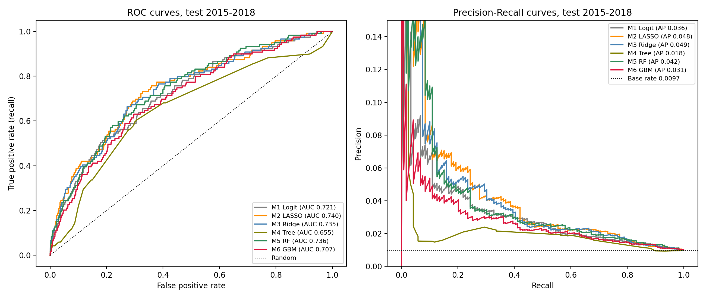
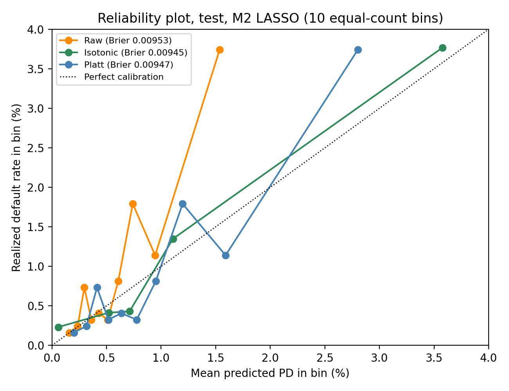

# Corporate Default & Distress Prediction

Which firms will default next year, and how well can financial ratios and market signals rank and price that risk when defaults are rare? This project compares six classifiers, from a plain logit to gradient boosting, on a strictly chronological split. It handles class imbalance, reads the models through risk deciles, and calibrates the predicted probabilities of default (PDs).

The analysis runs on an anonymized panel **simulated to reproduce the structure of a corporate-bankruptcy prediction problem** (see [Data](#data)), so the results show how the methods behave on realistic data, not new facts about real firms.

## Key results

| | |
|---|---|
| Best ranking model | LASSO logit: test **ROC-AUC 0.740**, KS 0.404 |
| Risk capture | riskiest 10% of firms hold **38.7%** of all test defaults |
| Rarity | 609 defaults in 78,682 firm-years (**0.77%**) |
| Calibration | raw PDs average 0.57% vs a realized 0.97%; Platt scaling fixes the level |

## Data

The data are **not included** and are not publicly available. The panel is anonymized and simulated to reproduce a realistic bankruptcy-prediction setting: 8,262 firms, fiscal years 1999–2018, 21 predictors (liquidity, leverage, profitability and efficiency ratios, plus market-based measures: market-to-book, size, prior-year return, return volatility and beta), broad industry codes and a next-year default flag.

The notebook expects four files in `data/`: `model_data_1999_2018.csv` (model-ready ratios), `raw_firm_year_1999_2018.csv` (inputs used to rebuild and verify the ratios), `annual_counts.csv` (yearly cross-checks) and `data_dictionary.csv`.

| Split | Fiscal years | Use |
|---|---|---|
| Train | 1999–2011 | fitting |
| Validation | 2012–2014 | every model choice (87 defaults) |
| Test | 2015–2018 | one final evaluation (12,282 firm-years, 119 defaults) |

A random split would mix firms and years and leak common shocks into training. The chronological split matches how a lender would use the model.

## Method

- **Checks first:** firm-year counts against the annual file, ratios rebuilt from raw inputs, no missing or infinite values.
- **Preprocessing (fit on train only):** winsorizing at the 1st/99th percentiles, standardizing, one-hot industry. Two exact identities (debt/assets = 1 − equity/assets, gross margin = 1 − COGS/sales) are dropped from the linear models.
- **Models:** logit, LASSO (C = 0.1), Ridge (C = 0.01), a decision tree (depth 6, leaf 200), a random forest (depth 6, leaf 50) and gradient boosting (learning rate 0.05, depth 2, 400 trees), with hyperparameters chosen on validation.
- **Class imbalance:** unweighted vs `class_weight="balanced"` vs 1:1 undersampling. They rank almost identically; rebalancing mainly shifts PDs upward.
- **Evaluation:** ROC-AUC, PR-AUC, KS, precision/recall/F1 at the validation-optimal cutoff, and default capture by risk decile.
- **Calibration and interpretation:** reliability curves with Platt and isotonic scaling; coefficients, tree splits and permutation importance.

## Findings

| Model | Test ROC-AUC | PR-AUC (AP) |
|---|---|---|
| LASSO logit | **0.740** | 0.048 |
| Random forest | 0.736 | 0.042 |
| Ridge logit | 0.735 | 0.049 |
| Logit | 0.721 | 0.036 |
| Gradient boosting | 0.707 | 0.031 |
| Decision tree | 0.655 | 0.018 |

(Base rate in test: 0.97%.)

- **Regularized logits rank best,** and the random forest is close. Gradient boosting had the best validation PR-AUC but fell back on test, which shows how noisy model rankings are with only 87 validation defaults.
- **Ranking works even when a 0.5 cutoff doesn't.** Predicted PDs are small, yet the top decile has several times the base default rate. Models with similar AUC differ by decile: Ridge suits a short review list, and the random forest suits wider screening.
- **Leverage, retained earnings and the prior-year stock return** drive predictions in both linear and tree models. Volatility (+) and size (−) have the expected signs. Collinear profitability ratios get conflicting signs in the plain logit; LASSO keeps only retained earnings.
- **Calibrate before use.** Raw PDs under-predict defaults. Recommendation: LASSO logit with Platt calibration, with the random forest as a challenger model.





## How to run

```bash
python -m venv .venv && source .venv/bin/activate
pip install -r requirements.txt
# place the four CSV files in data/
jupyter lab default_prediction.ipynb
```

## Repo layout

```
default_prediction.ipynb   full analysis with outputs
figures/                   all figures produced by the notebook
requirements.txt
```

## License

MIT. See [LICENSE](LICENSE).
